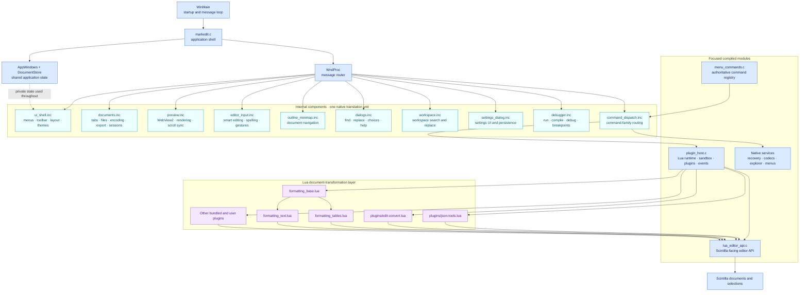

# MarkEdit architecture

MarkEdit keeps platform integration native and uses Lua as its document-transformation and extension layer.

## Structure diagram

The solid arrows show runtime delegation. The dotted state connection highlights
that the internal components currently share private application state because
they are included into the `markedit.c` translation unit.

## Native shell

`src/markedit.c` owns startup, the main window procedure and cross-subsystem orchestration. Large implementation components are kept in `src/internal/` and included at the point where their private declarations are available. They cover documents, dialogs, the UI shell, preview, debugger, editor input, outline/minimap, workspace operations, settings and command dispatch. In particular:

- `preview.inc`: WebView2 hosting, preview navigation and preview/editor synchronisation.
- `documents.inc`: document tabs, file operations, encodings, export and session behaviour.
- `dialogs.inc`: modal choices, text input, find/replace and help windows.
- `ui_shell.inc`: menus, toolbar, layout, view toggles and editor presentation.
- `debugger.inc`: source launching, compiler discovery, GDB/Python debugger control and breakpoint persistence.
- `editor_input.inc`: smart Tab/Enter, paired characters, spelling context actions and editor navigation gestures.
- `outline_minimap.inc`, `workspace.inc` and `settings_dialog.inc`: their named UI subsystems.
- `command_dispatch.inc`: native command-family handlers.

These components deliberately remain in the main translation unit for now. Their Win32 callbacks use substantial private application state; textual extraction improves navigation without replacing that dependency with a large public global interface. New code should not add dependencies across these boundaries. Once a component can be expressed through a small context structure, it can become a separate `.c` file.

`AppWindows` and `DocumentStore` in `markedit.c` group window handles and document ownership respectively. New state should be added to the appropriate structure rather than introduced as another unrelated global.

## Commands

`menu_commands.c` is the authoritative inventory of built-in command names, IDs and shortcuts. Menus refer to these stable names, and Lua overrides resolve through the same registry.

Native dispatch remains grouped by responsibility in `handle_file_command`, `handle_edit_command`, `handle_debug_command`, `handle_view_command` and `handle_help_command`. Lua overrides are resolved before native dispatch.

## Lua

`plugin_host.c` owns the Lua state, sandbox, commands, events, configuration, menu definitions, extension discovery, and the folder-local module loader. Bundled extensions load first and personal extensions from `%APPDATA%\markedit\plugins` load afterward. `lua_editor_api.c` owns the Scintilla-facing `editor.*` API, including bulk multi-selection operations.

The built-in formatter is stored as three focused files:

- `formatting_base.lua`: shared range helpers, inline formatting, line prefixes and snippets.
- `formatting_tables.lua`: Markdown table parsing and operations.
- `formatting_text.lua`: Markdown-aware Edit commands and formatting registration.

They are separate executable resources but are joined and compiled as one Lua chunk. This preserves private `local` helpers across the parts and makes loading atomic.

General Edit conversions live in `plugins/edit-convert.lua`, which creates the complete Edit → Convert submenu. Native code exposes only the small EOL-mode, tab-width, and save-encoding capabilities that text transformations cannot reproduce faithfully. JSON validation and transformations live entirely in `plugins/json-tools.lua`, which creates the Tools → JSON submenu and every item in it. The plugin supplies formatting, minification, validation, error highlighting, recursive key sorting, string escaping, JSON/YAML conversion, and optional live validation; the core contains no JSON tool commands. Delimited-text operations live in `plugins/csv-tools.lua`; its shared parser replaces the older CSV-to-Markdown implementation that was formerly duplicated in `markdown-tools.lua`. SQL, CLEF logs, data interchange, natural sorting, number conversion, and heuristic grammar checks are likewise ordinary bundled plugins and require no dedicated native commands.

Lua is preferred for commands whose main input and output are editor text. C remains preferred for filesystem and encoding work, recovery, windows and controls, COM, subprocesses, debugging, large-file streaming and per-keystroke behaviour. Moving one of those areas to Lua is useful only when the Lua API can expose a small capability rather than mirroring a native subsystem wholesale.

## Selection safety

Lua positions are one-based byte offsets and ranges are inclusive. `editor.get_selections()` returns a stable snapshot. `editor.replace_selections()` applies replacements from the end of the document and recreates the resulting carets, avoiding index and offset drift while a multi-caret edit is in progress.
