# MarkEdit architecture

MarkEdit keeps platform integration native and uses Lua as its document-transformation and extension layer.

## Structure diagram

```mermaid
flowchart TB
    entry["WinMain<br/>startup and message loop"] --> shell["markedit.c<br/>application shell"]
    shell --> state["AppWindows + DocumentStore<br/>shared application state"]
    shell --> wndproc["WndProc<br/>message router"]

    subgraph internal["Internal components · one native translation unit"]
        direction TB
        ui["ui_shell.inc<br/>menus · toolbar · layout · view toggles"]
        documents["documents.inc<br/>tabs · files · encoding · export · sessions"]
        preview["preview.inc<br/>WebView2 · rendering · scroll sync"]
        input["editor_input.inc<br/>smart editing · spelling · gestures"]
        outline["outline_host.inc<br/>editor outline host"]
        dialogs["dialogs.inc<br/>find · replace · choices · help"]
        workspace["workspace.inc<br/>workspace search and replace"]
        settings["settings_dialog.inc<br/>settings UI and persistence"]
        debugger["debugger.inc<br/>run · compile · debug · breakpoints"]
        dispatch["command_dispatch.inc<br/>command-family routing"]
        helphost["help_and_menu.inc<br/>help pages · menu owner-draw"]
        bridge["plugin_bridge.inc<br/>plugin service callbacks"]
        editorview["editor_view.inc<br/>editor text · theme · lexer · fonts"]
        controls["control_theme.inc<br/>window · menu · tab and list theming"]
        spelling["spell_check.inc<br/>Windows spell checking"]
        outputpanel["output_panel.inc<br/>Run output · terminal · debugger"]
        gitpanel["git_panel.inc<br/>Git tree · context actions"]
        recoveryhost["recovery_host.inc<br/>autosave recovery snapshots"]
    end

    wndproc --> ui
    wndproc --> documents
    wndproc --> preview
    wndproc --> input
    wndproc --> outline
    wndproc --> dialogs
    wndproc --> workspace
    wndproc --> settings
    wndproc --> debugger
    wndproc --> dispatch
    wndproc --> outputpanel
    debugger --> outputpanel
    outputpanel --> gitpanel
    state -.->|private state used throughout| ui

    subgraph compiled["Focused compiled modules"]
        registry["menu_commands.c<br/>authoritative command registry"]
        plugins["plugin_host.c<br/>host entry points · menu definition · themes.lua"]
        runtime["plugin_lua_runtime.c<br/>sandboxed state · limits · pcall"]
        pluginreg["plugin_registry.c<br/>plugin API · command/event registries"]
        discovery["plugin_discovery.c<br/>extension discovery · module loader"]
        editorApi["lua_editor_api.c<br/>Scintilla-facing editor API"]
        scintillaCfg["scintilla_config.c<br/>Scintilla view setup"]
        outlineMod["outline_minimap.c<br/>outline and minimap subsystem"]
        progress["progress_dialog.c<br/>IProgressDialog wrapper"]
        outputMod["output_process.c · output_text.c<br/>panel programs · output decoding"]
        themeMod["theme.c<br/>light/dark palettes · colour names"]
        nativeServices["Native services<br/>recovery · codecs · explorer · layout · menus"]
    end

    registry --> dispatch
    outputpanel --> outputMod
    dispatch --> plugins
    dispatch --> nativeServices
    dispatch --> outlineMod
    plugins --> runtime
    plugins --> pluginreg
    plugins --> discovery
    plugins --> themeMod
    pluginreg --> editorApi
    editorApi --> scintilla["Scintilla documents and selections"]

    subgraph lua["Lua document-transformation layer"]
        base["formatting_base.lua"]
        tables["formatting_tables.lua"]
        text["formatting_text.lua"]
        convert["plugins/edit-convert.lua"]
        json["plugins/json-tools.lua"]
        extensions["Other bundled and user plugins"]
    end

    plugins --> base
    base --> tables
    base --> text
    plugins --> json
    plugins --> convert
    plugins --> extensions
    json --> editorApi
    convert --> editorApi
    tables --> editorApi
    text --> editorApi
    extensions --> editorApi

    classDef native fill:#dbeafe,stroke:#2563eb,color:#172554
    classDef component fill:#ecfeff,stroke:#0891b2,color:#164e63
    classDef luaNode fill:#f3e8ff,stroke:#9333ea,color:#581c87
    class entry,shell,state,wndproc,registry,plugins,editorApi,nativeServices,scintilla native
    class ui,documents,preview,input,outline,dialogs,workspace,settings,debugger,dispatch,helphost,bridge,controls,outputpanel component
    class base,convert,json,tables,text,extensions luaNode
```

The solid arrows show runtime delegation. The dotted state connection highlights
that the internal components currently share private application state because
they are included into the `markedit.c` translation unit.

## Native shell

`src/markedit.c` owns startup, the main window procedure and cross-subsystem orchestration. Large implementation components are kept in `src/internal/` and included at the point where their private declarations are available. They cover documents, dialogs, the UI shell, preview, debugger, editor input, outline/minimap, workspace operations, settings and command dispatch. In particular:

- `preview.inc`: WebView2 hosting, preview navigation and preview/editor synchronisation.
- `documents.inc`: document tabs, file operations, encodings, export and session behaviour, plus the background access used to read or change other tabs' documents.
- `dialogs.inc`: modal choices, text input, find/replace and help windows, and the shared popup-dialog theming and buttons.
- `ui_shell.inc`: menus, toolbar, status bar, layout, view toggles and editor presentation.
- `debugger.inc`: source launching, compiler discovery, GDB/Python debugger control and breakpoint persistence.
- `output_panel.inc`: the output panel's Output tab, its input line and opening file locations from the output, plus starting, sizing, theming and stopping the Terminal tab, the Debug tab's status/variables/Continue-Step controls (populated by `debugger.inc`, shown via its `show_debug_panel()`), and asynchronous Git status/process integration. The Output tab's programs and Git queries run through `output_process.c`, whose reader batches available pipe output before posting it for `output_text.c` or `git_status.c` to decode; the Terminal tab is `terminal_view.c`, built around `terminal_process.c` (ConPTY and its worker threads), `terminal_grid.c` (the VT100 screen and bounded scrollback ring), and `terminal_input.c` (Win32-key to VT-sequence translation).
- `git_panel.inc`: Git branch caches and commands plus the Git tab's TreeView rendering, checkbox/context-menu interaction and deferred file/branch actions.
- `editor_input.inc`: smart Tab/Enter, paired characters, spelling context actions and editor navigation gestures.
- `outline_host.inc`, `workspace.inc` and `settings_dialog.inc`: their named UI subsystems.
- `command_dispatch.inc`: native command-family handlers.
- `help_and_menu.inc`: help windows, the generated shortcuts page and menu-bar owner-draw.
- `plugin_bridge.inc`: the service callbacks the plugin host reaches the application through (prompts, message boxes, document actions, the output panel).
- `editor_view.inc`: reading and replacing editor text, and setting up each Scintilla view: theme colours, the language lexer, view options and the editor font. It is included first because every other component uses it.
- `control_theme.inc`: main window, menu-bar and title-bar theming, splitter painting, and owner-drawn tab and list-item theming. It is included next because the remaining components use it.
- `spell_check.inc`: native Windows spell checking of Markdown prose, and the batched, multithreaded checking behind the plugin API's `spell.check`.
- `recovery_host.inc`: autosave recovery snapshots, written through `recovery.c`.

These components deliberately remain in the main translation unit for now. Their Win32 callbacks use substantial private application state; textual extraction improves navigation without replacing that dependency with a large public global interface. New code should not add dependencies across these boundaries. Once a component can be expressed through a small context structure, it can become a separate `.c` file. `outline_minimap.c`, `progress_dialog.c` and `scintilla_config.c` have already crossed that line.

`spell_check.inc` has not. It shares a live `ISpellChecker` with the editor's right-click context menu and leans on several shell helpers (`get_edit_text`, `save_layout_settings`, `refresh_menu`, `show_choice_dialog`) plus `g_activeLanguage` and `g_largeFile`, so it presently needs more than a small context to stand alone.

`AppWindows` and `DocumentStore` in `markedit.c` group window handles and document ownership respectively. New state should be added to the appropriate structure rather than introduced as another unrelated global. `DocumentStore` is the single owner of the open-document array; the old `g_documents`/`g_documentCount`/`g_activeDocument` macros that shadowed its fields are gone, so edits go through `g_documentStore.<field>` directly.

## Module map and layering

Each compiled module has one header and a short, one-directional list of
dependencies. Lower rows may only depend on higher rows; the `settings_*.h`
split and `layout_metrics` exist so the persistence code is not forced to
depend on a UI module.

| Module | Header | Responsibility | Depends on |
| --- | --- | --- | --- |
| `settings_values.h` | — | Persisted preference values, metrics (`SPLITTER_WIDTH`), `CompilerBackendPreference` | windows.h |
| `find_state.h` | — | Transient Find/Replace dialog state | windows.h, commdlg.h |
| `settings_io.h` | — | Load/save entry points over the values above | `settings_values.h` |
| `layout_metrics.{h,c}` | `layout_metrics.h` | Explorer geometry values and `explorer_content_x()` | `settings_values.h` |
| `settings.h` | — | Umbrella over the three headers above, for the app shell only | `settings_values.h`, `settings_io.h`, `find_state.h` |
| `path_utils.c` | `path_utils.h` | Path manipulation, `LONG_PATH_CAPACITY`, and the per-user `%LOCALAPPDATA%\MarkEdit` folders | shlwapi |
| `text_codec.c` | `text_codec.h` | UTF-8/16 and BOM handling | — |
| `git_status.c` | `git_status.h` | NUL-delimited Git porcelain v2 status parsing, including branch tracking state and exact UTF-8 paths | none (pure logic) |
| `file_io.c` | `file_io.h` | Atomic file read/write helpers | `path_utils.h` |
| `workspace_text.c` | `workspace_text.h` | Workspace text helpers | — |
| `plugin_settings.c` | `plugin_settings.h` | Sectioned JSON settings store shared by application preferences and Lua plugins | `file_io.h` |
| `preview_fallback.c` | `preview_fallback.h` | Self-contained preview page for WebView2 runtimes without virtual-host folder mapping | — |
| `markdown.c` | `markdown.h` | Markdown rendering via cmark-gfm | cmark-gfm |
| `settings.c` | `settings_io.h` | Persistence | `settings_values.h`, `settings_io.h`, `find_state.h`, `layout_metrics.h`, `path_utils.h`, `plugin_settings.h`, `text_codec.h` |
| `recent_list.c` | `recent_list.h` | Recent-files list | `settings_io.h` |
| `file_explorer.c` | `file_explorer.h` | Explorer panel and tree | `layout_metrics.h`, `settings_values.h`, `theme.h` |
| `recovery.c` | `recovery.h` | Crash-recovery snapshots | `file_io.h`, `path_utils.h` |
| `toolbar_icons.c` / `themed_scrollbar.c` | matching | Owner-drawn UI helpers | windows.h, uxtheme |
| `editor_commands.c` | `editor_commands.h` | Text operations on a supplied Scintilla view (no application state) and the shared margin indices | Scintilla |
| `editor_language.c` | `editor_language.h` | Language metadata, extension matching, and Scintilla syntax colours | `theme.h`, Scintilla, Lexilla |
| `outline_minimap.c` | `outline_minimap.h` | Outline panel and minimap, driven through a host struct | `editor_commands.h`, `editor_language.h`, `settings_io.h`, `settings_values.h`, `text_codec.h`, `theme.h`, Scintilla |
| `theme.c` | `theme.h` | The light and dark `ThemePalette`s: every colour by role, its `themes.lua` name and built-in value, and the template Customize Theme Colours writes | `settings_values.h` |
| `scintilla_config.c` | `scintilla_config.h` | Scintilla view setup: margins, markers, wrap/whitespace/indent, gutter sizing | `editor_commands.h`, `settings_values.h`, `themed_scrollbar.h`, Scintilla |
| `progress_dialog.c` | `progress_dialog.h` | Marquee progress dialog wrapper (IProgressDialog) | windows.h, shlobj, ole32 |
| `plugin_host.c` | `plugin_host.h` | Plugin host entry points, menu definition, help page rendering, and running a `themes.lua` in a Lua state of its own | `plugin_host_internal.h`, `lua_editor_api.h` |
| `plugin_lua_runtime.c` | (internal) | Sandboxed `lua_State`, memory/time limits, protected calls | `plugin_host_internal.h` |
| `plugin_registry.c` | (internal) | `ui`/`menu`/`contextmenu`/`events`/`commands`/`config`/`app`/`documents`/`spell`/`output`/`problems` API and registries | `plugin_host_internal.h` |
| `plugin_discovery.c` | (internal) | Extension discovery and the folder-local `require` loader | `plugin_host_internal.h`, `file_io.h`, `path_utils.h` |
| `lua_editor_api.c` | `lua_editor_api.h` | Scintilla-facing `editor.*` API | Scintilla |
| `menu_commands.c` | `menu_commands.h` | Command registry | `command_ids.h` |
| `app_accelerators.c` | `app_accelerators.h` | Fixed Win32 accelerator table, kept in sync with command shortcut labels by menu tests | `command_ids.h`, windows.h |
| `output_process.c` | `output_process.h` | A program on pipes in a kill-on-close job, with immediately available output batched before its reader thread posts it to the UI | windows.h |
| `output_text.c` | `output_text.h` | Output decoding (ANSI colours, carriage returns, OEM fallback), file locations in messages | windows.h |
| `terminal_process.c` | `terminal_process.h` | A shell on a Windows pseudoconsole (ConPTY) in a kill-on-close job; a batched reader posts output, an ordered writer drains queued input, and a watcher reports shell exit | windows.h |
| `terminal_grid.c` | `terminal_grid.h` | VT100/ECMA-48 screen buffer: cursor-addressed cells, SGR colours, scroll regions, the alternate screen, and bounded ring-buffer scrollback | none (pure logic) |
| `terminal_input.c` | `terminal_input.h` | Pure translation of Win32 virtual keys and modifier flags into xterm-compatible VT input sequences | windows.h for virtual-key constants |
| `terminal_view.c` | `terminal_view.h` | The Terminal tab's rendering and input control, owning one `TerminalProcess` and one `TerminalGrid`; repeated keys are batched and focused keyboard messages are handled before queued output and application accelerators | `terminal_process.h`, `terminal_grid.h`, `terminal_input.h` |
| `markedit.c` + `src/internal/*.inc` | `markedit.h` | Application shell and subsystems | everything above |

Two dependency rules fall out of the table:

- **Persistence does not depend on UI.** `settings.c` includes `layout_metrics.h`
  for the explorer's geometry values, not `file_explorer.h`; loading or saving
  preferences never needs the tree control.
- **Headers are included at the narrowest scope that works.** A module that only
  reads persisted values includes `settings_values.h`; only `markedit.c` pulls in
  the umbrella `settings.h`.

## Responsiveness and background work

The UI thread owns Win32 controls, terminal-grid mutation and painting. Work that
can block is kept outside it:

- `terminal_process.c` uses three workers. The reader drains currently available
  ConPTY output into chunks of up to 64 KB, the writer drains a lock-protected
  input queue in order, and the watcher waits for shell exit. Key handlers only
  encode and enqueue bytes; they never wait in `WriteFile`.
- The main message loop explicitly takes pending messages for the focused
  terminal from `WM_KEYFIRST` through `WM_KEYLAST` before ordinary posted output
  messages. This prevents sustained output from starving keys. Auto-repeat bytes
  are assembled in small batches before they enter the writer queue.
- `terminal_grid.c` stores at most 2,000 scrollback rows in a ring. Once full, a
  new line replaces the oldest slot in O(1); do not reintroduce an array-wide
  `memmove` on rollover.
- `output_process.c` similarly drains immediately available pipe data into a
  64 KB batch before posting it, reducing UI messages and decoder/repaint passes.
  `output_text.c` then copies bounded runs of ordinary ASCII instead of feeding
  the decoder one byte at a time.
- Edit and selection notifications are coalesced by the main-window timers
  before `text_changed` and `selection_changed` reach Lua. Live analyzers should
  use those events directly; adding a second debounce only delays their result.
- File-explorer change filtering scans path components in place. It must remain
  allocation-free because a busy workspace watcher can call it for every change.

Other hot paths stay linear: outline rebuilding walks Scintilla's stable
character buffer instead of sending messages for every line, bulk multi-caret
replacement carries one cumulative offset, folder replacement advances through
its sorted matches once, preview rendering passes its known byte length to
`markdown_to_html_n()` rather than rescanning the document, SQL formatting
collects line pieces before joining them, occurrence counting advances one line
cursor, and the anagram index counts letters instead of sorting every word.

Compiled sources are listed in the repo-root `*.rsp` response files.
The default MSVC scripts read `markedit-sources.rsp`, `cmark-gfm-sources.rsp`,
`lua-sources.rsp` and `lexilla-sources.rsp` and compile each dependency with
its own include and warning policy. `plugin-sources.rsp` lists the plugin-host
subset for `test.bat` and the Premake test projects; those files are also in
`markedit-sources.rsp`. MSVC whole-program optimization lets the final link
optimize across the separately compiled modules and vendored static objects.
`release-flags.rsp` contains the corresponding GCC/Zig flags for the optional
Premake builds.
`premake5.lua` reads the source lists via `sources_from_rsp()`, so adding a new
`.c` file is a one-line change to its `.rsp` rather than an edit in two build
systems.

`tests/test_ui_smoke.ps1` runs after the packaged build. It launches MarkEdit
with isolated AppData folders and drives stable Win32 command/control IDs to
verify output-panel tab switching, close/reopen, Git reopening and resize
layout. `.github/workflows/windows.yml` runs the warning-free unit suite, the
release build and this smoke harness on Windows.

## Commands

`menu_commands.c` is the authoritative inventory of built-in command names, IDs and shortcuts. Menus refer to these stable names, and Lua overrides resolve through the same registry.

Native dispatch remains grouped by responsibility in `handle_file_command`, `handle_edit_command`, `handle_debug_command`, `handle_view_command` and `handle_help_command`. Lua overrides are resolved before native dispatch.

## Lua

The plugin host is split across four files. `plugin_lua_runtime.c` owns the sandboxed Lua state, memory/time limits and protected calls; `plugin_registry.c` owns the API plugins see (`ui`, `menu`, `contextmenu`, `events`, `commands`, `config`, `app`, `documents`, `spell`, `output`, `problems`), the command and event registries and running a registered command; `plugin_discovery.c` owns extension discovery and the folder-local module loader; and `plugin_host.c` keeps the entry points, the menu definition and help page rendering. Bundled extensions load first and personal extensions from `%APPDATA%\markedit\plugins` load afterward. `lua_editor_api.c` owns the Scintilla-facing `editor.*` API, including bulk multi-selection operations.

The built-in formatter is stored as three focused files:

- `formatting_base.lua`: shared range helpers, Markdown inline formatting, line prefixes and snippets.
- `formatting_tables.lua`: Markdown table parsing and operations.
- `formatting_text.lua`: Markdown-aware Edit commands and formatting registration.

They are separate executable resources but are joined and compiled as one Lua chunk. This preserves private `local` helpers across the parts and makes loading atomic.

HTML snippets live in `plugins/html-tools.lua`, which creates Snippets → HTML without built-in command IDs. Markdown structure and link transformations, offline linting, and document/selection statistics similarly live in `plugins/markdown-tools.lua`, `plugins/markdown-linter.lua`, and `plugins/selection-statistics.lua`.

General Edit conversions live in `plugins/edit-convert.lua`, which creates the complete Edit → Convert submenu. Native code exposes only the small EOL-mode, tab-width, and save-encoding capabilities that text transformations cannot reproduce faithfully. JSON tools live entirely in two plugins that share the Tools → JSON submenu: `plugins/json-check.lua` supplies syntax checking (strict JSON, JSONC and JSON Lines), JSON paths and error highlighting as you type; `plugins/json-tools.lua` supplies formatting, minification, recursive key sorting, string escaping and JSON/YAML conversion. The core contains no JSON tool commands. Delimited-text operations live in `plugins/csv-tools.lua`; its shared parser replaces the older CSV-to-Markdown implementation that was formerly duplicated in `markdown-tools.lua`. SQL, CLEF logs, data interchange, natural sorting, number conversion, and heuristic grammar checks are likewise ordinary bundled plugins and require no dedicated native commands.

Lua is preferred for commands whose main input and output are editor text. `menu.add` can also supply an enabled predicate, evaluated with the active editor whenever menu state is refreshed, so plugins can keep context-specific commands visibly unavailable without native command-state cases. C remains preferred for filesystem and encoding work, recovery, windows and controls, COM, subprocesses, debugging, large-file streaming and per-keystroke behaviour. Moving one of those areas to Lua is useful only when the Lua API can expose a small capability rather than mirroring a native subsystem wholesale.

## Selection safety

Lua positions are one-based byte offsets and ranges are inclusive. `editor.get_selections()` returns a stable snapshot. `editor.replace_selections()` applies replacements from the end of the document and recreates the resulting carets, avoiding index and offset drift while a multi-caret edit is in progress.
