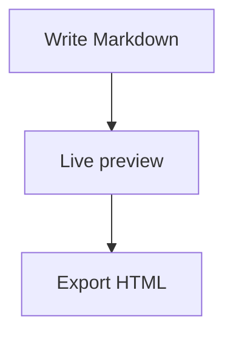

# MarkEdit Markdown Reference

CommonMark with GitHub-flavoured extensions and MarkEdit preview features.
Edit this document freely to experiment - it is unsaved, so nothing is
overwritten.

## Headings

```
# Heading 1
## Heading 2
### Heading 3
###### Heading 6
```

H1 and H2 can also be made by underlining the preceding text:

```
Heading 1
=========
Heading 2
---------
```

Headings receive link anchors; two or more also show an Outline control.

## Paragraphs and line breaks

Separate paragraphs with a blank line.
End a line with two spaces or a backslash for a hard line break.

## Emphasis and inline code

| Markdown | Result |
| :--- | :--- |
| `**bold**` or `__bold__` | **bold** |
| `*italic*` or `_italic_` | *italic* |
| `***bold italic***` | ***bold italic*** |
| `~~strikethrough~~` | ~~strikethrough~~ |
| `` `inline code` `` | `inline code` |

Escape Markdown punctuation with a backslash: \*literal asterisks\*

## Links, images, autolinks

```
[link text](https://example.com)
[link with title](https://example.com "Optional title")

[relative link](docs/guide.md)
<https://example.com>
https://example.com (bare URLs are linked automatically)
```

Relative links and images resolve from the Markdown file's folder.
Pasting an image, or dropping one onto the editor, copies it into an
`images` folder beside the document and inserts a relative link.

Reference-style links:

```
[link text][id]

[id]: https://example.com
```

## Wiki-links

```
[[Other Note]]
[[Other Note|custom label]]
```

Click a wiki-link to open that note from the current document's folder (a
`.md` extension is assumed unless one is given), or offer to create it if
it doesn't exist yet. File > Go Back (Alt+Left) returns to wherever the
jump was made from.

## Emoji shortcodes

| Markdown | Result |
| :--- | :--- |
| `:tada:` | :tada: |
| `:rocket:` | :rocket: |
| `:+1:` | :+1: |
| `:100:` | :100: |
| `:fire:` | :fire: |

An unrecognised shortcode such as `:not_a_real_shortcode:` is left as
plain text.

## Lists

- bullet item
- another item
  - nested item

1. first
2. second
   1. nested

Ordered lists may start at any number. Indent items to nest them.
Pressing Enter continues a list and Tab nests the current item.

Task lists:

- [ ] an unchecked task
- [x] a checked task

## Blockquotes and alerts

> a quoted line

> [!NOTE]
> Useful information for the reader.

> [!TIP]
> An optional suggestion.

> [!IMPORTANT]
> Something the reader must not miss.

> [!WARNING]
> A consequence the reader should be careful of.

> [!CAUTION]
> A risk that needs care.

## Code blocks

Indent with 4 spaces, or fence with triple backticks. Add a language for
syntax highlighting, such as `c`, `python`, `javascript`, `powershell`,
or `yaml`.

```c
int main(void) {
    return 0;
}
```

## Mermaid diagrams

Fence diagram source with the `mermaid` language. Use the preview toolbar
or Ctrl+mouse wheel to zoom; drag to pan.



## Maths

Inline: Euler's identity is $e^{i\pi} + 1 = 0$.

Display: $$\int_0^1 x^2 dx = \frac{1}{3}$$

Fenced display maths:

```math
\frac{-b \pm \sqrt{b^2 - 4ac}}{2a}
```

## Tables

Colons in the separator row set column alignment.

| Left | Centre | Right |
| :--- | :----: | ----: |
| A | B | C |
| longer cell | centred | 42 |

## Footnotes

A sentence with a note.[^1]

[^1]: The footnote text.

## YAML front matter

A metadata block must start on the document's first line. It is omitted
from the preview and may close with either `---` or `...`

```
---
title: Example
tags: [notes, demo]
---
```

## Horizontal rules

Three or more `-`, `*`, or `_` on their own line:

---

## Preview safety

Raw HTML is omitted. Unsafe `javascript:` and `data:` URLs are not linked.
